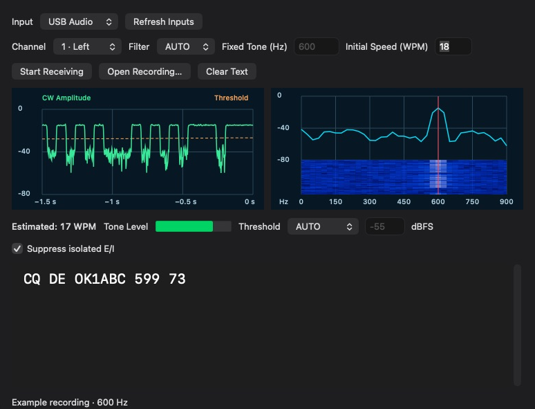

# CW Decoder


CW Decoder is a native macOS app that turns Morse code audio into text. It receives from any compatible macOS audio input, including a radio's USB audio output, an external audio interface, or a microphone listening to a radio speaker or another audible CW source. It also decodes saved audio recordings.



## Build and open

Install the Xcode Command Line Tools, then run:

```sh
./build.sh
open "build/CW Decoder.app"
```

The build includes the macOS app icon and uses an ad hoc signature for local use.

## Decode live audio

1. Select an **Input**, such as a USB audio interface, the Mac's built-in microphone, or **Default macOS Input**. Choose the channel that carries the tone. The app remembers the input for the next launch.
2. Click **Start Receiving** and allow audio input access if macOS asks. If using a microphone, place it near the CW source and reduce other sounds in the room. For a radio, select CW mode and tune the station so its tone is audible.
3. The **AUTO** filter follows the strongest distinct tone from 200 to 1450 Hz and holds its frequency across short gaps. **FIX** uses **Fixed Tone (Hz)**. The status line shows the current decoding frequency, and the red marker shows it on the 0–900 Hz spectrum when it is in view.
4. **Initial Speed (WPM)** accepts 8–65 WPM. **Estimated** shows the rate measured from received marks and gaps. The app adjusts word spacing and starts a new line after at least 1.5 seconds without keying, or 12 dot lengths at slower speeds.
5. The left graph shows the CW amplitude and detection threshold over the last 1.5 seconds. **AUTO** adapts the threshold to the signal and noise. **MANUAL** uses a fixed threshold in dBFS. **Suppress isolated E/I** hides isolated groups such as `E`, `EE`, and `II`; turn it off to see those groups.

For example, the Icom IC-9700 typically appears as **USB Audio CODEC** and the IC-7300 as **USB Audio Device**. On the IC-9700, select `MENU → SET → Connectors → USB AF/IF Output → Output Select → AF` and `AF SQL → OFF (Open)`. An initial `AF Output Level` of 50% is a starting point.

## Decode a recording

Click **Open Recording…** and select an audio file, such as a WAV. The app uses the chosen channel, filter, threshold, and initial speed. An unrecognized character appears as `_`. The decoder recognizes punctuation such as `?` and `_` as well as common prosigns like `⟨SK⟩`.

## Reuse the decoder

`Decoder.swift` contains the standalone `CWDecoder` class. Create one instance per channel with the sample rate, CW tone frequency, and initial WPM estimate. Pass mono PCM `Float` samples to `consume` in order and append its returned text. Use `tune(to:)` for frequency changes. Create a new instance when the sample rate changes or a new recording starts. Feed a short tail of silence after the final samples so the decoder can emit the last character.
