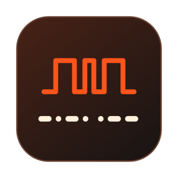

# IC-9700 CW

A standalone Morse code decoder for macOS. It decodes one CW signal at a time from a Core Audio input or an audio recording.

## Receive from a radio

1. Connect the radio's rear USB-B port to your Mac. On the IC-9700, set `MENU → SET → Connectors → USB AF/IF Output → Output Select → AF` and `AF SQL → OFF (Open)`. Leave `AF Output Level` at 50% for an initial test.
2. Open `build/IC-9700 CW.app`. Select the radio's audio input, such as `USB Audio CODEC` for the IC-9700 or `USB Audio Device` for the IC-7300. Select channel 1, click **Start Receiving**, and allow audio input access if macOS asks. If the signal is on the other channel, stop receiving and select channel 2. The app remembers the selected audio input.
3. Set the radio to CW and tune a station. The **AUTO** filter follows the strongest distinct tone from 200 to 1450 Hz and holds its frequency across short gaps. The status line shows the current decoding frequency. The spectrum and waterfall show 0–900 Hz, with a red marker when the selected tone is in view. In **FIX** mode, set **Fixed Tone (Hz)** to the radio's `CW PITCH`.
   The left graph shows the tracked tone and detection threshold over the last 1.5 seconds. The **AUTO** threshold adapts to the signal and noise levels and falls gradually after the signal stops. **MANUAL** uses a fixed threshold in dBFS.
4. **Initial Speed (WPM)** accepts 8–65 WPM. **Estimated** shows the rate measured from marks and gaps. The decoder adapts its word spacing to the received signal. It starts a new line after at least 1.5 seconds without keying, or 12 dot lengths at slower speeds.
5. **Suppress isolated E/I** is on by default. It hides isolated groups such as `E`, `EE`, and `II`. To see valid standalone `E` and `I` groups, stop receiving and turn the filter off.

An unrecognized character appears as `_`. The decoder displays `..--..` as `?` and `..--.-` as an underscore.

**Open Recording…** decodes an audio file, such as a WAV, using the selected tone, speed, and channel settings.

## Build and integrate

Run `./build.sh` in this directory with the Xcode Command Line Tools installed.

`Decoder.swift` contains the standalone `CWDecoder` class. Create one instance per channel with the sample rate, CW tone frequency, and initial WPM estimate. Pass mono PCM `Float` samples to `consume` in order and append its returned text. Use `tune(to:)` for a frequency change. Create a new instance when the sample rate changes or a new recording starts. For files, feed a short tail of silence after the final samples so the decoder can emit the last character.
